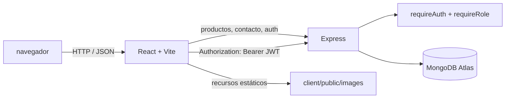

# Hermanos Jota

Catálogo web para una mueblería, construido con React y una API REST en Express con MongoDB. Permite explorar productos, consultar sus detalles, armar un carrito y, para las cuentas administradoras, gestionar el catálogo.

## Despliegues

- Frontend (Vercel): https://trastienda-muebleria-hermanos-jota.vercel.app
- Backend (Render): https://trastiendamuebleriahermanosjota.onrender.com

## Descripción

Hermanos Jota es una aplicación web de presentación y exploración de muebles. Está pensada para personas que quieren conocer el catálogo, buscar productos por nombre y revisar sus características antes de contactar a la tienda.

El frontend obtiene los datos desde una API propia, que los guarda en MongoDB Atlas. Los clientes pueden registrarse, iniciar sesión y armar un carrito; los administradores pueden crear, editar y eliminar productos. El carrito calcula cantidades y el total, pero es temporal y no procesa pedidos ni pagos.

## Funcionalidades

### Público

- Inicio con productos destacados.
- Catálogo con búsqueda por nombre, sin distinguir mayúsculas ni acentos.
- Vista de detalle con descripción, precio, stock, imagen y especificaciones.
- Formulario de contacto, cuyos mensajes se guardan en la base de datos.
- Página 404 para direcciones que no existen.

### Cuentas

- Registro e inicio de sesión con correo y contraseña.
- Contraseñas guardadas con hash bcrypt; nunca se almacenan en texto plano.
- Sesión mediante un token JWT, que el cliente envía en el encabezado `Authorization`.
- Límite de intentos: 10 inicios de sesión cada 15 minutos por conexión y correo, y 5 registros por hora por conexión.
- Dos roles: `cliente` y `admin`.

### Clientes

- Carrito con modificación de cantidades, eliminación de productos, vaciado y cálculo del total.

### Administración de productos

- Panel de administración en `/admin`.
- Alta, edición y eliminación de productos desde el panel, el catálogo o el detalle.
- Las rutas de administración están protegidas en el cliente, y los endpoints de escritura de productos exigen un token de administrador en el backend.
- Si la base rechaza un dato (por ejemplo, un precio negativo o un stock con decimales), la API responde 400 con el motivo, y el formulario lo muestra.

El carrito se guarda únicamente en el estado de la aplicación: se vacía al recargar la página. No hay checkout ni gestión de pedidos.

## Tecnologías utilizadas

### Frontend

- React 19
- React Router DOM 7, con rutas dinámicas (`useParams`)
- Context API para la sesión
- Vite 8
- Tailwind CSS 4
- lucide-react para iconografía

### Backend

- Node.js
- Express 5
- MongoDB Atlas con Mongoose 9
- bcrypt para el hash de contraseñas
- jsonwebtoken para la autenticación
- CORS y dotenv

### Herramientas

- npm workspaces para organizar frontend y backend en un monorepo.
- concurrently para iniciar ambos servicios durante el desarrollo.
- ESLint para analizar el cliente.

## Arquitectura

El cliente React consulta la API de Express, que lee y escribe en MongoDB Atlas mediante Mongoose. Las imágenes de los productos se guardan como URL en cada producto. Las imágenes propias de la interfaz, como el logo y el hero, se sirven desde `client/public/images`. En desarrollo, Vite redirige las solicitudes de `/api` al backend.

Al iniciar sesión, la API devuelve un JWT con el identificador y el rol del usuario. El cliente lo guarda en `sessionStorage`, lo expone mediante Context API y lo envía en cada petición protegida. En el backend, el middleware `requireAuth` verifica el token y `requireRole` comprueba el rol.



### API disponible

Con el backend en `http://localhost:3000`:

| Método y ruta | Acceso | Descripción |
| --- | --- | --- |
| `GET /` | Público | Mensaje de estado de la API. |
| `GET /api/productos` | Público | Catálogo completo. |
| `GET /api/productos/destacados` | Público | Hasta tres productos destacados. |
| `GET /api/productos/:id` | Público | Un producto; 404 si no existe. |
| `POST /api/productos` | Admin | Crea un producto. |
| `PUT /api/productos/:id` | Admin | Actualiza un producto. |
| `DELETE /api/productos/:id` | Admin | Elimina un producto. |
| `POST /api/auth/register` | Público | Crea una cuenta de cliente. |
| `POST /api/auth/login` | Público | Devuelve un JWT y los datos del usuario. |
| `GET /api/auth/me` | Con sesión | Datos del usuario del token. |
| `POST /api/contacto` | Público | Guarda un mensaje del formulario de contacto. |
| `GET /api/contacto` | Público | Lista los mensajes de contacto. |
| `DELETE /api/contacto/:id` | Público | Elimina un mensaje de contacto. |

Respuestas de error: 400 para datos inválidos, 401 sin sesión válida, 403 sin permiso, 404 si el recurso no existe y 429 al superar el límite de intentos.

## Estructura del proyecto

```text
.
├── backend/
│   ├── config/
│   │   └── db.js                   # Conexión a MongoDB
│   ├── controllers/
│   │   ├── apiController.js        # Respuesta de estado de la API
│   │   ├── authController.js       # Registro, login y usuario actual
│   │   ├── contactoController.js
│   │   └── productoController.js
│   ├── middlewares/
│   │   ├── errorHandler.js         # Respuestas de error y validación
│   │   ├── logger.js               # Registro de solicitudes
│   │   ├── notFound.js             # Rutas no encontradas
│   │   ├── rateLimit.js            # Límite de intentos
│   │   ├── requireAuth.js          # Verificación del JWT
│   │   └── requireRole.js          # Control de roles
│   ├── models/
│   │   ├── contacto.model.js
│   │   ├── producto.model.js
│   │   └── usuario.model.js
│   ├── routes/
│   │   ├── authRoutes.js
│   │   ├── contactoRoutes.js
│   │   └── productoRoutes.js
│   ├── scripts/
│   │   └── createAdmin.js          # Crea o promueve la cuenta administradora
│   ├── .env.example
│   ├── index.js                    # Configuración e inicio de Express
│   └── package.json
├── client/
│   ├── public/
│   │   └── images/                 # Recursos estáticos del sitio
│   ├── src/
│   │   ├── components/
│   │   │   ├── admin/              # Layout y formulario de productos
│   │   │   ├── carrito/
│   │   │   ├── catalogo/           # Detalle y acciones de administración
│   │   │   ├── home/
│   │   │   ├── ContactForm.jsx
│   │   │   ├── ProductCard.jsx
│   │   │   ├── ProductList.jsx
│   │   │   └── ProtectedRoute.jsx  # Rutas por rol
│   │   ├── config/
│   │   │   └── api.js              # URL base de la API
│   │   ├── context/                # Sesión con Context API
│   │   ├── pages/                  # Inicio, catálogo, login, registro, admin y 404
│   │   ├── service/                # Llamadas a la API
│   │   ├── utils/
│   │   ├── App.jsx                 # Rutas y estado de la aplicación
│   │   ├── Footer.jsx
│   │   ├── main.jsx
│   │   └── Navbar.jsx
│   ├── .env.example
│   ├── package.json
│   ├── vercel.json                 # Redirección de rutas a index.html
│   └── vite.config.js
├── .gitignore
├── package.json                    # Workspaces y comandos del monorepo
├── package-lock.json
└── README.md
```

## Requisitos

- Node.js 20.19 o superior, o 22.12 o superior (requisito de Vite 8).
- npm.
- Un cluster de MongoDB Atlas.

## Instalación y ejecución

Desde la raíz del repositorio, instalar las dependencias, configurar las variables de entorno (ver más abajo) e iniciar el cliente y el backend:

```bash
npm install
npm run dev
```

Por defecto, Vite inicia el frontend en `http://localhost:5173` y Express escucha en `http://localhost:3000`.

Para iniciar cada servicio por separado:

```bash
npm run dev:client
npm run dev:backend
```

Para ejecutar el backend sin modo de desarrollo:

```bash
npm run start
```

### Crear la cuenta administradora

Las cuentas creadas desde el registro son de tipo `cliente`. Para tener un administrador, completar `ADMIN_EMAIL` y `ADMIN_PASSWORD` en `backend/.env` y ejecutar desde la carpeta `backend`:

```bash
npm run seed:admin
```

El script crea la cuenta en la base configurada en `MONGO_URI`. Si el correo ya existe, la convierte en administradora y reemplaza su contraseña.

### Variables de entorno

| Variable | Servicio | Obligatoria | Descripción |
| --- | --- | --- | --- |
| `MONGO_URI` | Backend | Sí | URI de conexión a MongoDB Atlas. Sin ella, el servidor no inicia. |
| `JWT_SECRET` | Backend | Sí | Clave para firmar los tokens. Debe ser larga y aleatoria. Sin ella, el login responde con error. |
| `JWT_EXPIRES_IN` | Backend | No | Duración de la sesión, por ejemplo `30m`, `1h` o `7d`. Su valor predeterminado es `1h`. |
| `ADMIN_EMAIL` | Backend | Solo para `seed:admin` | Correo de la cuenta administradora. |
| `ADMIN_PASSWORD` | Backend | Solo para `seed:admin` | Contraseña de la cuenta administradora: entre 8 caracteres y 72 bytes. |
| `PORT` | Backend | No | Puerto HTTP de Express. Su valor predeterminado es `3000`; Render lo define automáticamente. |
| `VITE_API_BASE_URL` | Frontend | Solo en producción | URL base de la API, sin `/api` al final. Si se omite, el cliente usa rutas relativas, que Vite redirige al backend durante el desarrollo. |

#### Desarrollo local

Crear los archivos de configuración a partir de los ejemplos. Los archivos `.env` no se suben al repositorio.

```bash
cp backend/.env.example backend/.env
cp client/.env.example client/.env
```

Completar `backend/.env`, incluido el nombre de la base en `MONGO_URI`:

```env
MONGO_URI=mongodb+srv://<usuario>:<contraseña>@<tu_cluster>.mongodb.net/<nombre_de_tu_base_de_datos>?retryWrites=true&w=majority
JWT_SECRET=<clave_larga_y_aleatoria>
JWT_EXPIRES_IN=1h
ADMIN_EMAIL=<correo_del_administrador>
ADMIN_PASSWORD=<contraseña_del_administrador>
```

Para generar un valor para `JWT_SECRET`:

```bash
node -e "console.log(require('crypto').randomBytes(48).toString('hex'))"
```

En desarrollo, `VITE_API_BASE_URL` puede quedar vacía en `client/.env`.

La IP desde la que se ejecuta el backend debe estar autorizada en Atlas, en **Network Access**.

#### Producción

- **Render:** en **Environment**, definir `MONGO_URI`, `JWT_SECRET` (distinto del de desarrollo) y, si se quiere, `JWT_EXPIRES_IN`. Las variables `ADMIN_*` no hacen falta en Render. El servicio usa `backend` como Root Directory, `npm install` como Build Command y `npm start` como Start Command. Atlas debe permitir conexiones desde `0.0.0.0/0`, porque Render no tiene una IP fija en el plan gratuito.
- **Vercel:** en **Settings → Environment Variables**, definir `VITE_API_BASE_URL` con la URL del backend en Render. El proyecto usa `client` como Root Directory. Vite incorpora esta variable al compilar, por lo que después de cambiarla hay que volver a desplegar.

## Verificación

Ejecutar el análisis estático del cliente y generar el build de producción:

```bash
npm run lint --workspace client
npm run build
```
