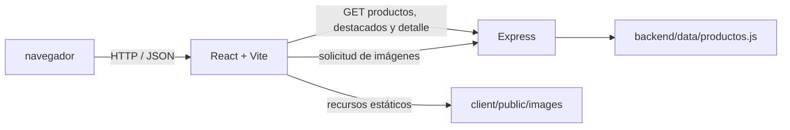

# Hermanos Jota

Catálogo web para una mueblería, construido con React y una API REST en Express. Permite explorar productos, consultar sus detalles y armar un carrito de compra en la interfaz.

## Despliegues

- Frontend (Vercel): https://trastienda-muebleria-hermanos-jota.vercel.app
- Backend (Render): https://trastiendamuebleriahermanosjota.onrender.com

## Descripción

Hermanos Jota es una aplicación web de presentación y exploración de muebles. Está pensada para personas que quieren conocer el catálogo, buscar productos por nombre y revisar sus características antes de contactar a la tienda.

El frontend obtiene el catálogo desde una API propia. Los datos actuales se mantienen en un módulo JavaScript del backend; no se utiliza una base de datos. El carrito permite calcular cantidades y el total, pero es temporal y no procesa pedidos ni pagos.

## Funcionalidades

- Inicio con productos destacados.
- Catálogo de productos con búsqueda por nombre, sin distinguir mayúsculas ni acentos.
- Vista de detalle con descripción, precio, imagen y especificaciones disponibles.
- Carrito con modificación de cantidades, eliminación de productos, vaciado y cálculo del total.
- Navegación entre inicio, catálogo y carrito; enlaces de contacto en el pie de página.
- API para consultar todos los productos, los destacados o un producto por identificador.
- Respuesta 404 para rutas no encontradas y para identificadores de producto inexistentes.

El carrito se guarda únicamente en el estado de la aplicación: se vacía al recargar la página. No hay checkout, gestión de pedidos, persistencia, autenticación ni administración de productos.

## Tecnologías utilizadas

### Frontend

- React 19
- Vite 8
- Tailwind CSS 4
- lucide-react para iconografía

### Backend

- Node.js
- Express 5
- CORS

### Datos

- Catálogo estático definido en `backend/data/productos.js`.
- No hay motor de base de datos configurado.

### Herramientas

- npm workspaces para organizar frontend y backend en un monorepo.
- concurrently para iniciar ambos servicios durante el desarrollo.
- ESLint para analizar el cliente.

## Arquitectura

El cliente React solicita el catálogo al servidor Express, y consulta por separado los productos destacados y el detalle de cada producto. El backend responde con los datos del módulo local y también publica las imágenes almacenadas en `backend/imagenes`. En desarrollo, Vite redirige las solicitudes de `/api` y `/imagenes` al backend. Las imágenes propias de la interfaz, como el logo y el hero, se sirven desde `client/public/images`.



### API disponible

Con el backend en `http://localhost:3000`:

- `GET /` devuelve un mensaje de estado de la API.
- `GET /api/productos` devuelve el catálogo completo.
- `GET /api/productos/destacados` devuelve hasta tres productos destacados.
- `GET /api/productos/:id` devuelve el producto cuyo identificador coincide; responde 404 si no existe.
- `POST /api/contacto` recibe mensajes del formulario de contacto.
- `/imagenes/*` sirve los archivos de imágenes del backend.

## Estructura del proyecto

```text
.
├── backend/
│   ├── config/                 
│   ├── controllers/           
│   │   ├── apiController.js    # Respuesta de estado de la API
│   │   ├── contactoController.js
│   │   └── productoController.js
│   ├── data/
│   │   └── productos.js        # Datos del catálogo
│   ├── imagenes/               # Imágenes servidas por Express
│   ├── middlewares/
│   │   ├── errorHandler.js     # Respuestas de error
│   │   ├── logger.js           # Registro de solicitudes
│   │   └── notFound.js         # Rutas no encontradas
│   ├── models/                 
│   ├── routes/
│   │   ├── contactoRoutes.js
│   │   └── productoRoutes.js
│   ├── index.js                # Configuración e inicio de Express
│   ├── package.json
│   └── package-lock.json
├── client/
│   ├── public/
│   │   └── images/             # Recursos estáticos del sitio
│   ├── src/
│   │   ├── assets/             # Recursos importados por el cliente
│   │   ├── config/
│   │   │   └── api.js          # URL base de la API y de imágenes
│   │   ├── components/
│   │   │   ├── carrito/
│   │   │   │   └── CarritoView.jsx
│   │   │   ├── catalogo/
│   │   │   │   └── ProductDetail.jsx
│   │   │   ├── home/
│   │   │   │   ├── Hero.jsx
│   │   │   │   └── ProductosDestacados.jsx
│   │   │   ├── ProductCard.jsx
│   │   │   └── ProductList.jsx
│   │   ├── pages/
│   │   │   ├── CatalogoView.jsx
│   │   │   └── HomeView.jsx
│   │   ├── utils/
│   │   │   └── formatPrice.js
│   │   ├── App.jsx             # Estado y navegación de la aplicación
│   │   ├── Footer.jsx
│   │   ├── index.css
│   │   ├── main.jsx
│   │   └── Navbar.jsx
│   ├── eslint.config.js
│   ├── index.html
│   ├── package.json
│   ├── package-lock.json
│   ├── README.md
│   └── vite.config.js
├── .github/
│   └── agents/
│       └── auditor-frontend-senior.agent.md
├── .gitignore
├── package.json                # Workspaces y comandos del monorepo
├── package-lock.json
└── README.md
```
## Requisitos

- Node.js 20.19 o superior, o 22.12 o superior (requisito de Vite 8).
- npm.

## Instalación y ejecución

Desde la raíz del repositorio, instalar las dependencias e iniciar el cliente y el backend:

```bash
npm install
npm run dev
```

Por defecto, Vite inicia el frontend en `http://localhost:5173` y Express escucha en `http://localhost:3000`.

Para iniciar cada servicio por separado:

```bash
npm run dev:client
npm run dev:backend
```

Para ejecutar el backend sin modo de desarrollo:

```bash
npm run start
```

### Variables de entorno

| Variable | Servicio | Obligatoria | Descripción |
| --- | --- | --- | --- |
| `MONGO_URI` | Backend | Sí | URI de conexión a MongoDB Atlas. Sin ella, el servidor no inicia. |
| `PORT` | Backend | No | Puerto HTTP de Express. Su valor predeterminado es `3000`; Render lo define automáticamente. |
| `VITE_API_BASE_URL` | Frontend | Solo en producción | URL base de la API, sin `/api` al final. Si se omite, el cliente usa rutas relativas, que Vite redirige al backend durante el desarrollo. |

#### Desarrollo local

Crear el archivo del backend a partir del ejemplo y completar `MONGO_URI` con los datos del cluster, incluido el nombre de la base. Los archivos `.env` no se suben al repositorio.

```bash
cp backend/.env.example backend/.env
```

```env
MONGO_URI=mongodb+srv://<usuario>:<contraseña>@<tu_cluster>.mongodb.net/<nombre_de_tu_base_de_datos>?retryWrites=true&w=majority
```

La IP desde la que se ejecuta el backend debe estar autorizada en Atlas, en **Network Access**.

#### Producción

- **Render:** en **Environment**, definir `MONGO_URI`. El servicio usa `backend` como Root Directory, `npm install` como Build Command y `npm start` como Start Command. Atlas debe permitir conexiones desde `0.0.0.0/0`, porque Render no tiene una IP fija en el plan gratuito.
- **Vercel:** en **Settings → Environment Variables**, definir `VITE_API_BASE_URL` con la URL del backend en Render. El proyecto usa `client` como Root Directory. Vite incorpora esta variable al compilar, por lo que después de cambiarla hay que volver a desplegar.

## Verificación

Ejecutar el análisis estático del cliente y generar el build de producción:

```bash
npm run lint --workspace client
npm run build
```
